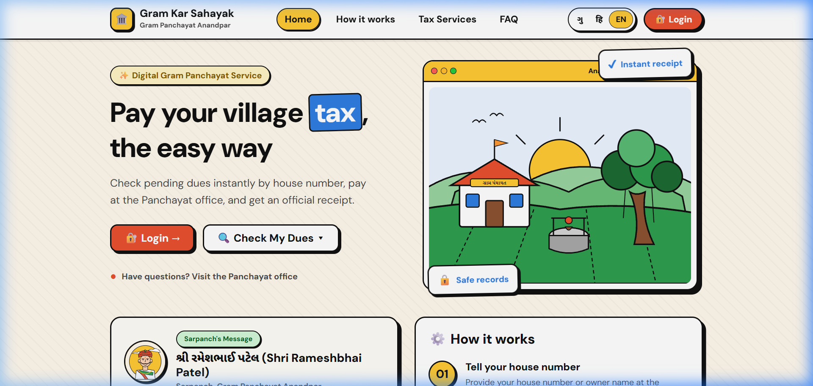
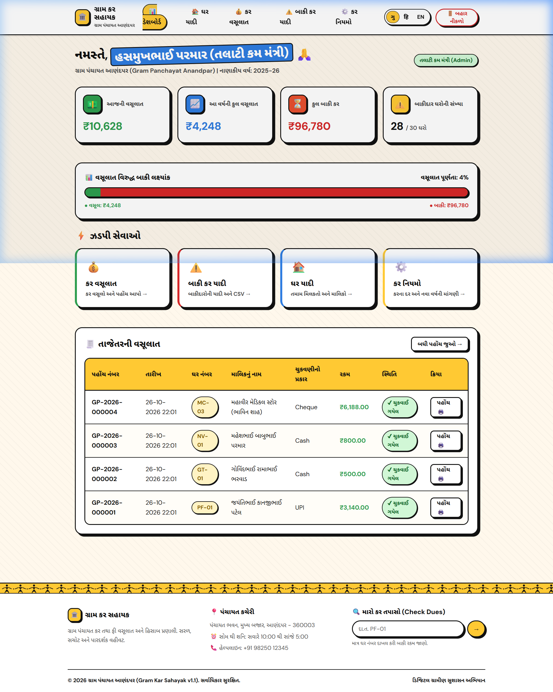
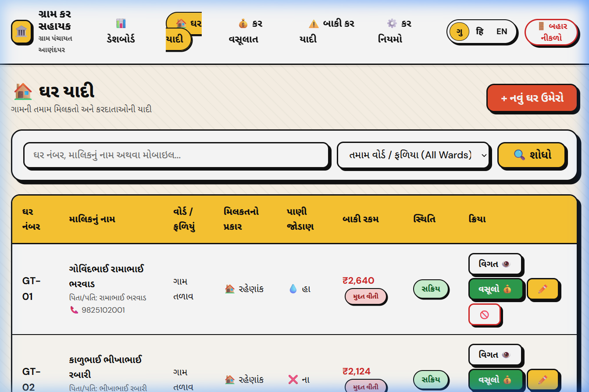
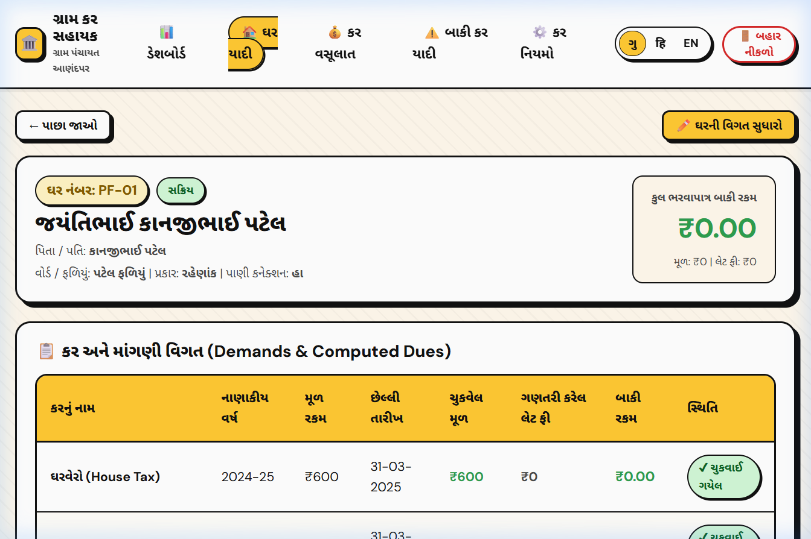
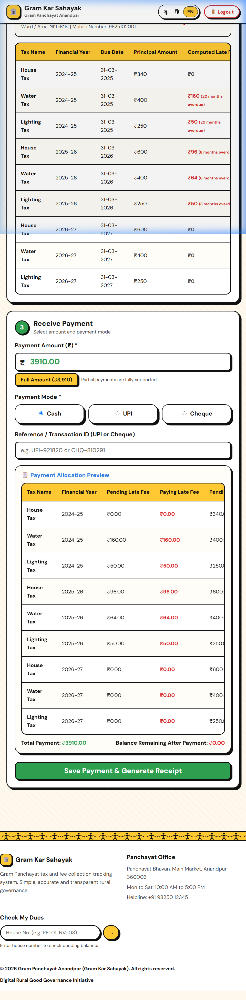
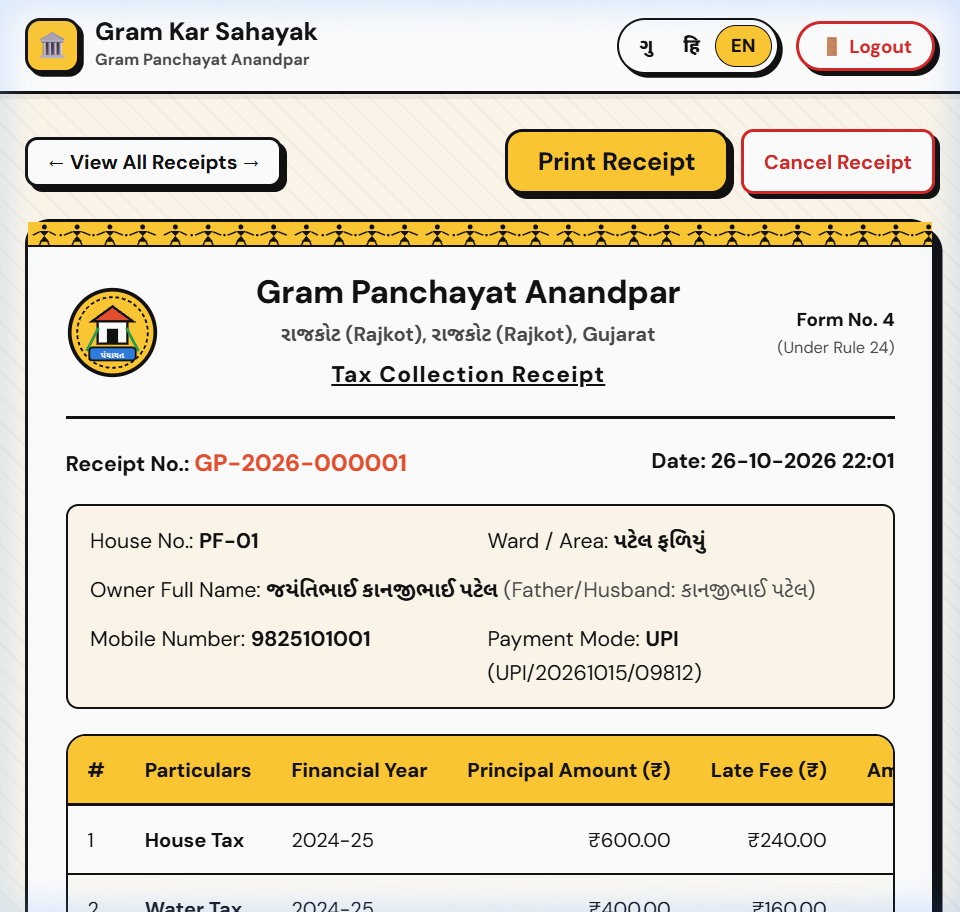
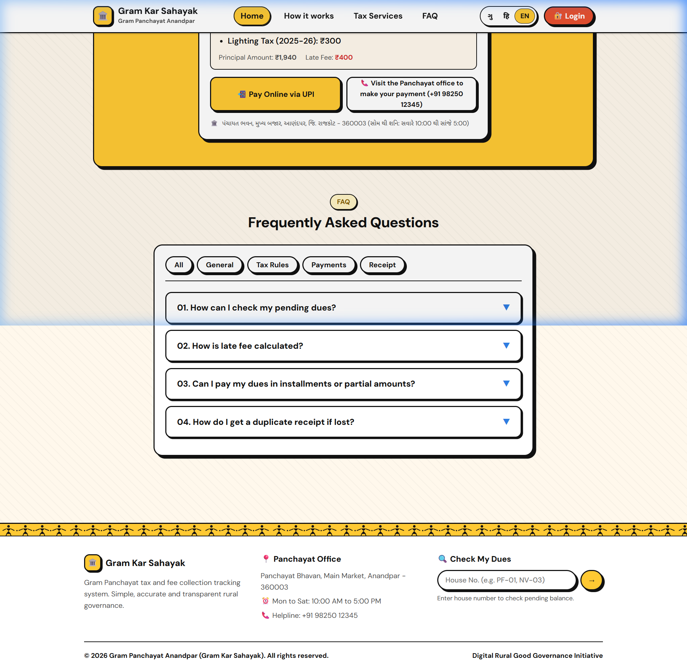
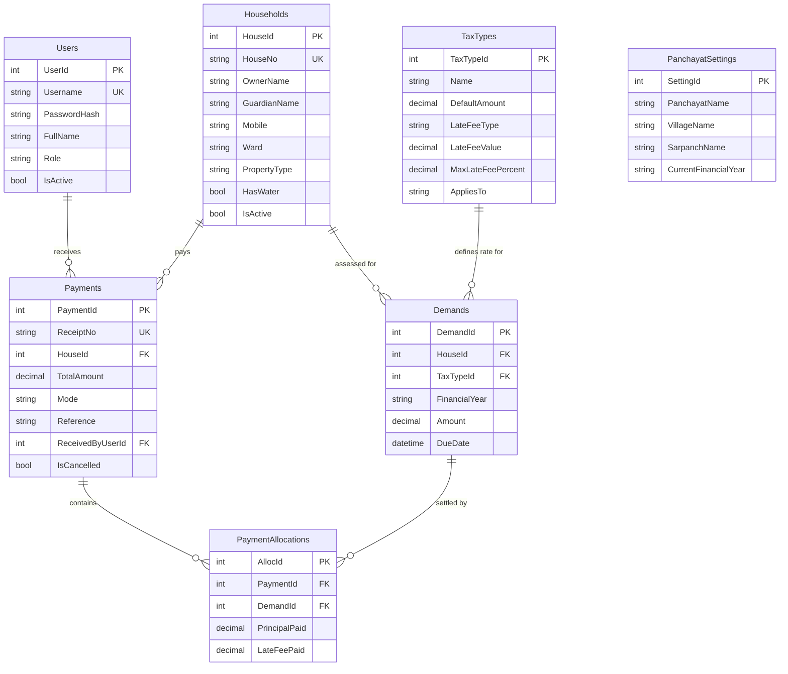

# Gram Kar Sahayak (ગ્રામ કર સહાયક)
### Digital Tax Assessment, Collection & Audit System for Gujarat Gram Panchayats

[](https://dotnet.microsoft.com/)
[](https://learn.microsoft.com/ef/core/)
[](https://www.mysql.com/)
[](https://panchayat.gujarat.gov.in/)
[-F59E0B)](https://github.com/kaifansariw/Gram_Kar_Sahayak)

---

## 1. Executive Summary & Legal Compliance

In thousands of Gram Panchayats across Gujarat, local tax collection (મકાન વેરો / ઘરવેરો, પાણીવેરો, દિવાબત્તી કર, સફાઈ કર) is still recorded across paper ledgers (*Panchayat Namuna 4 & 5*). This paper-bound process creates three systemic bottlenecks:

1. **Revenue Leakage**: Late fees are manually estimated or waived arbitrarily without an automated penalty formula.
2. **Citizen Inconvenience**: Village residents must physically visit the Panchayat office during limited hours simply to discover their pending dues.
3. **Audit Vulnerabilities**: Lack of strict sequential numbering on receipts enables accidental double-billing or unrecorded cash transactions.

**Gram Kar Sahayak (ગ્રામ કર સહાયક)** is an enterprise e-governance platform designed for Gram Panchayats operating under the **Gujarat Panchayats Act, 1993**. It automates the complete lifecycle: property tax assessment, compounding late fee calculations, multi-mode tax recovery (Cash / UPI / Cheque), real-time FIFO allocation, citizen self-service dues lookup, and statutory **Form No. 4 (Rule 24)** printable receipts.

---

## 2. Key Architectural Highlights

* **Automated FIFO Tax Allocation Engine**: Prevents arbitrary write-offs by strictly allocating incoming payments in statutory sequence: *Oldest Accrued Late Fees ➔ Oldest Principal Dues ➔ Current Financial Year Taxes*.
* **Multi-Modal Receipt Generation (Form No. 4)**: Instant generation of immutable, sequential receipts (`GP-YYYY-XXXXXX`) formatted to A4/A5 government standards, with QR verification and cancellation audit logs.
* **Neubrutalism Design System**: High-contrast, tactile UI with 2.5px solid borders, heavy drop shadows (`3px 3px 0 #111`), large readable fonts, and distinct color tokens (`--turmeric`, `--leaf`, `--terracotta`). Built intentionally for low-cost monitors, dusty Panchayat office environments, and outdoor sunlight readability.
* **Native Tri-Lingual Localization**: Gujarati (ગુજરાતી), Hindi (हिंदी), and English (EN) integrated at the core via custom dictionary-based localization (`translations.json`) without external runtime API dependencies.
* **Citizen Self-Service Portal**: Open-access portal where villagers can search their house number (`GT-01`, `PF-03`) or mobile number, view an itemized assessment breakdown, and execute test online UPI payments with digital receipt generation.
* **Dual Database Architecture**: Auto-switching database layer supporting zero-configuration **SQLite** (`gramkosh.db`) for immediate offline demonstration and **MySQL 8.0** for production Panchayat clusters with UTF-8 Gujarati collation (`utf8mb4_unicode_ci`).

---

## 3. Visual System Walkthrough

### 3.1 Citizen Portal & Public Tax Verification
The public-facing landing page allows any village resident to look up their pending demands by house number or registered mobile without logging in.



---

### 3.2 Real-Time Executive Dashboard
Provides the Sarpanch and Talati-cum-Mantri with instant visibility into recovery targets, collection percentages, ward-wise collection breakdown, and monthly recovery trajectories.



---

### 3.3 Village Household & Property Register
Complete register of village properties across all wards (*Patel Faliya, Gam Talav, Nava Vas, Mandir Chowk*). Supports property status management (Active / Inactive), water connection tracking, and instant navigation to household dues statements.



---

### 3.4 Property Dues Statement & Demand History
Detailed statement of an individual household showing all historical demand assessments, principal balance, late fee compounding, payment records, and net outstanding balance.



---

### 3.5 Tax Collection & Real-Time Allocation (Step 1 to 3)
Interactive collection workflow featuring fuzzy household lookup (supports variations like `GT-01`, `gt01`, mobile, or owner name), itemized overdue breakdown, partial payment support, and live dynamic allocation preview.



---

### 3.6 Statutory Receipt Generation (Panchayat Form No. 4, Rule 24)
Standardized government-format tax collection receipt featuring the official emblem, taluka/district headers, itemized tax allocation, payment mode, unique sequential receipt number, and printer-ready CSS styles (`window.print()`).



---

### 3.7 Citizen Digital UPI Payment Drawer
Integrated online UPI QR payment flow allowing citizens to pay dues remotely, verify transaction references, and download stamped digital payment confirmations.



---

## 4. Business Logic & Core Algorithms

### 4.1 FIFO Payment Allocation Algorithm
When a citizen makes a partial or lump-sum payment, funds cannot be applied randomly. The system enforces the statutory **FIFO (First-In, First-Out) Priority Rule**:

```
Input: HouseId, TotalAmountPaid
Sorted Demands = LoadDemands(HouseId) ORDER BY DueDate ASC, FinancialYear ASC

RemainingAmount = TotalAmountPaid

// Phase 1: Clear Oldest Outstanding Late Fees First
FOR EACH demand IN SortedDemands:
    feeDue = demand.CalculatedLateFee - demand.Allocations.Sum(LateFeePaid)
    IF feeDue > 0 AND RemainingAmount > 0:
        feeToPay = MIN(feeDue, RemainingAmount)
        RecordAllocation(demand, LateFeePaid = feeToPay)
        RemainingAmount -= feeToPay

// Phase 2: Clear Oldest Principal Amounts
FOR EACH demand IN SortedDemands:
    principalDue = demand.Amount - demand.Allocations.Sum(PrincipalPaid)
    IF principalDue > 0 AND RemainingAmount > 0:
        principalToPay = MIN(principalDue, RemainingAmount)
        RecordAllocation(demand, PrincipalPaid = principalToPay)
        RemainingAmount -= principalToPay
```

### 4.2 Late Fee Calculation Rules
Late fees are calculated based on the statutory rules defined in `TaxTypes`:
1. **Percentage Rule (e.g. 2% per month)**:
   $$\text{Late Fee} = \text{Principal} \times \left(\frac{\text{Rate}}{100}\right) \times \text{Overdue Months}$$
   *Capped at 50% of the principal amount to prevent unrecoverable citizen debt.*
2. **Flat Penalty Rule (e.g. Fixed ₹50)**:
   Applied once the assessment crosses the statutory due date (typically March 31 of the financial year).

---

## 5. Role-Based Access Control (RBAC) Matrix

| Feature / Action | Citizen (Public) | Sarpanch | Talati-cum-Mantri (Admin) |
|---|:---:|:---:|:---:|
| Check Property Dues & Statements | Yes | Yes | Yes |
| Online UPI Payment (Self-Service) | Yes | Yes | Yes |
| View Financial Dashboard & KPIs | No | Yes | Yes |
| Record Tax Collection (Cash/UPI/Cheque) | No | No | Yes |
| Print Form No. 4 Receipts | Yes (Self) | Yes | Yes |
| Cancel Receipt (Audit Trail Logged) | No | No | Yes |
| Add / Edit Household Register | No | No | Yes |
| Configure Tax Rules & Rates | No | No | Yes |
| Run Yearly Dues Demand Generator | No | No | Yes |

---

## 6. Technical Stack

| Layer | Technology | Description |
|---|---|---|
| **Framework** | ASP.NET Core 8.0 MVC | C# 12, Strongly-typed Razor Views |
| **ORM** | Entity Framework Core 8.0 | Code-First with Migration & Seeder Pipeline |
| **Relational Database** | MySQL 8.0 & SQLite | MySQL with Pomelo EF Provider / SQLite fallback |
| **Authentication** | Cookie Authentication | Encrypted auth tickets, 20-minute idle sliding session |
| **Frontend Architecture** | Vanilla HTML5 / Modern CSS | Neubrutalism design system, responsive flex/grid layouts |
| **Client Scripts** | Vanilla JavaScript (ES6+) | Live allocation preview, debounced search, modal controls |
| **Localization** | Custom JSON Localizer | Tri-lingual engine (`gu`, `hi`, `en`) with URL state |

---

## 7. Database Entity Relationship Diagram (ERD)



---

## 8. Installation & Setup Guide

### 8.1 Prerequisites
* [.NET 8.0 SDK](https://dotnet.microsoft.com/download/dotnet/8.0) or later
* Git
* *(Optional)* [MySQL Server 8.0](https://dev.mysql.com/downloads/mysql/) & [MySQL Workbench](https://dev.mysql.com/downloads/workbench/)

### 8.2 Clone & Run (Zero-Config SQLite Mode)
By default, the application runs out-of-the-box with local SQLite (`gramkosh.db`):

```bash
# 1. Clone repository
git clone https://github.com/kaifansariw/Gram_Kar_Sahayak.git
cd Gram_Kar_Sahayak

# 2. Restore packages and build
dotnet restore
dotnet build

# 3. Launch application
dotnet run
```

Access the application in your browser:
👉 **`http://localhost:5209`**

---

### 8.3 Switching to MySQL 8.0 / MySQL Workbench

1. Open **MySQL Workbench** and establish connection to your local server.
2. Open the included script:
   [`database_mysql.sql`](database_mysql.sql)
3. Execute the script (press `Ctrl + Shift + Enter`) to create `gramkosh_db`, all 7 tables, and the complete seed dataset.
4. Update [`appsettings.json`](appsettings.json) with your MySQL password:
   ```json
   "ConnectionStrings": {
     "DefaultConnection": "Server=localhost;Port=3306;Database=gramkosh_db;Uid=root;Pwd=YOUR_MYSQL_PASSWORD;",
     "SqliteConnection": "Data Source=gramkosh.db"
   },
   "DatabaseProvider": "MySQL"
   ```
5. Restart the application. EF Core will run directly on MySQL.

---

## 9. Default Demo Credentials

| Role | Username | Password | Purpose |
|---|---|---|---|
| **Talati-cum-Mantri (Admin)** | `admin` | `Admin@123` | Full access to tax collections, household edits, settings & cancellations |
| **Sarpanch** | `sarpanch` | `Sarpanch@123` | Executive dashboard, ward collection monitoring, citizen queries |
| **Citizen (Public)** | *No login needed* | *N/A* | Public portal dues check, online payment demonstration, print statements |

---

## 10. Project Directory Layout

```
Gram_Kar_Sahayak/
├── Program.cs                  # Host configuration, DI, auth & database auto-detection
├── database_mysql.sql          # Complete MySQL 8.0 DDL & initial seed dataset
├── translations.json           # Tri-lingual dictionary (Gujarati / Hindi / English)
├── run.bat                     # 1-Click launcher script with process cleanup
├── Controllers/
│   ├── HomeController.cs       # Landing page, public lookup & UPI payment
│   ├── AccountController.cs    # Authentication & session control
│   ├── DashboardController.cs  # Analytics & ward recovery metrics
│   ├── HouseholdsController.cs # Property register & dues statements
│   ├── PaymentsController.cs   # Tax collection & Form No. 4 receipts
│   └── SettingsController.cs   # Tax rates & Panchayat settings
├── Services/
│   ├── DuesCalculator.cs       # Compound late fee & dues calculator
│   ├── PaymentService.cs       # FIFO allocation engine & receipt logic
│   ├── DemandGenerator.cs      # Yearly tax demand batch processor
│   └── LocalizerService.cs     # Multi-lingual dictionary service
├── Models/
│   ├── Entities/               # EF Core database entity classes
│   └── ViewModels/             # UI data transfer and validation models
├── Views/                      # Neubrutalism Razor templates
├── wwwroot/                    # CSS tokens, client JS, SVG emblems
└── docs/screenshots/           # High-resolution documentation images
```

---

## 11. License & Contribution

This project is open-source under the **MIT License**. Contributions, bug reports, and enhancements adhering to Gujarat E-Governance standards are welcome via pull requests.
